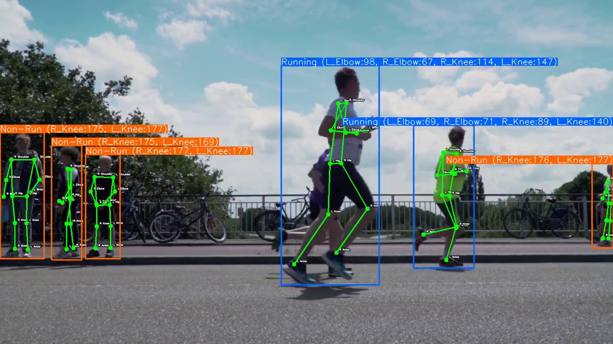
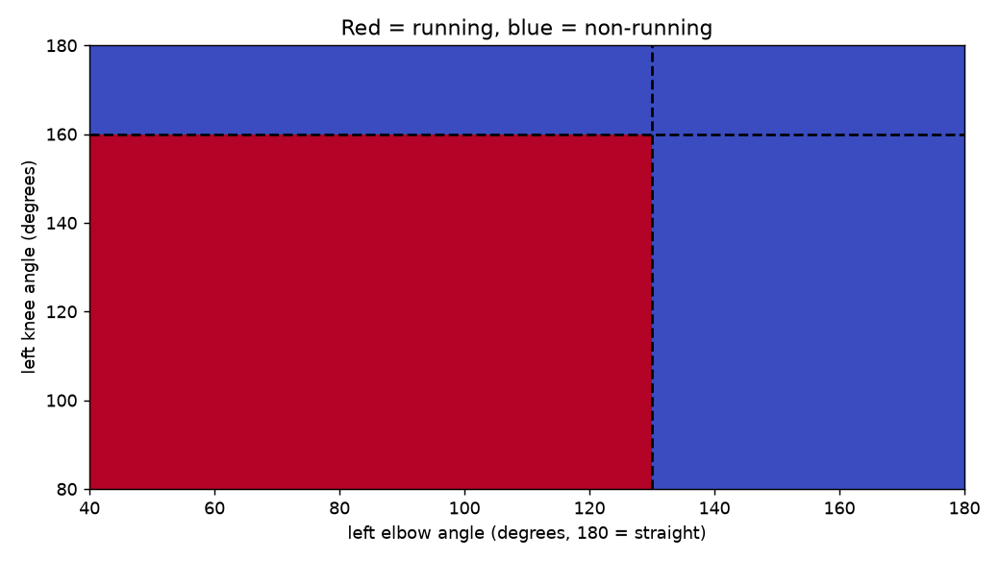

# Running Detection from Pose Keypoints


**Problem:** in a crowd video, tell people who are running from people who are not, without training a new model: take the 2D body keypoints a YOLO pose model already gives you and measure joint angles.

The rule is a pure function of 17 keypoints, so it runs without a GPU or a video, is unit tested, and its behaviour is documented below.



(Frame from the original demo video; the video itself is not in the repo.)

## The rule

[`posture/movement.py`](posture/movement.py) measures the angle at each visible elbow and knee (180 degrees is a straight limb) and labels each person:

- **running**: at least one elbow is bent below 130 degrees **and** at least one knee is bent below 160 degrees;
- **non-running**: both legs are visible and the running pattern does not hold;
- **unknown**: otherwise (for example a leg is hidden). The rule says "unknown" rather than guess.

Keypoints use the COCO-17 layout, with a joint counted as visible above 0.3 confidence.

## How the rule behaves

There is no labelled video in this repo, so no accuracy number is claimed. Instead [`run_analysis.py`](run_analysis.py) bends one elbow and one knee of a synthetic skeleton through a grid of angles and records the verdict.



- The rule switches exactly at the two thresholds: red (running) only where the elbow is below 130 and the knee is below 160 degrees. Full grid: [`results/angle_grid.csv`](results/angle_grid.csv).
- Hidden joints change the answer in ways worth knowing ([`results/occlusion_cases.csv`](results/occlusion_cases.csv)). With the same bent arm and leg:
  - all joints visible: running;
  - a hidden ankle or knee: **unknown** (the rule needs both legs to say non-running);
  - the bent arm's wrist hidden: **non-running**, because only the straight arm is left. A visible straight arm is treated as evidence against running.

### Known weaknesses (not fixed)

- It uses **one frame**. Walking also bends elbows and knees, so a single bent-arm, bent-knee frame can be a walker mid-stride. Running is really a property of motion over time (speed, cadence), which this rule cannot see.
- Angles are measured in 2D image space, so a person facing the camera can look "straight-limbed" while running, and an elbow pointing at the camera is foreshortened.
- The 130 and 160 degree thresholds were set by eye on a crowd video, not tuned on labelled data.
- Crowded scenes give partial occlusion, so many people come out `unknown`.

A sound next step is to track each person across frames and use keypoint speed (body movement per second) with the angles, evaluated on a labelled dataset.

## Changes from the earlier repo

This repo replaces `YOLO-MovementType-Detection`. The logic moved out of a 190-line video script into testable functions; behaviour is unchanged.

## Run it

The rule and tests need only numpy:

```bash
python -m venv .venv && source .venv/bin/activate   # Windows: .venv\Scripts\activate
pip install -r requirements.txt
pytest                      # 9 tests
python run_analysis.py      # regenerates results/
```

To annotate a video (needs ultralytics and OpenCV; the model weights are downloaded by ultralytics on first use):

```bash
pip install -r requirements-video.txt
python run_video.py input.mp4 output.mp4
```

## Layout

```
posture/
  keypoints.py   COCO-17 indices, visibility helper
  movement.py    running vs non-running from joint angles
  synthetic.py   synthetic skeleton for tests and the angle sweep
  video.py       YOLO pose + OpenCV video runner (optional dependencies)
run_analysis.py  angle sweep and occlusion cases -> results/
run_video.py     command line for annotating a video
tests/           9 unit tests
```
